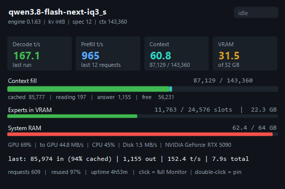

# Strata system-tray monitor

A system-tray icon for a [Strata](https://github.com/Niko1221/Strata) server. Hover the icon and a
card appears: answer speed, prompt-reading speed, context fill, VRAM, experts cached in VRAM, system
RAM, GPU / CPU / disk load, and the last request.

The point is to skip the browser trip when all you want to know is whether the server is alive, how
full the context is, and how fast it is going. The right-click menu can also start and stop the model,
so you do not need a console window for it either.



**Strata's terminal app** (`terminal/`, `strata launch`, `strata runtime`) is what this drives. It does
not control the Strata desktop app in `app/` - that one has its own window and its own controls.

## Run it

```
start-tray.vbs                  start it, hidden          <- the normal way
run-tray-console.bat            start it in a console, with event logging
stop-tray.ps1                   stop every running copy
```

Nothing to install: it uses Windows PowerShell 5.1 and WinForms, both already on Windows. No admin
rights needed. Start / Stop in the menu also need Strata's own command line on PATH (`strata`); if it
is somewhere else, set `$StrataCmd` in `settings.local.ps1`.

Optional switches: `-Url`, `-Every` (poll seconds, default 1.5), `-Page`, `-NoControl` (watch only),
`-Preview out.png`, `-Once`, `-CtlSelfTest` (print the menu rows and exit), `-TraceOn` / `-Trace file.log`.

## Which server it watches

In order: `-Url` on the command line, then `settings.local.ps1` next to the script, then Strata's own
default port **8080**.

If your server is on a different port, copy the template and edit that - never the script:

```
copy settings.local.example.ps1 settings.local.ps1
```

`settings.local.ps1` is gitignored, so your port never ends up in the repo.

## Gestures

| gesture | result |
|---|---|
| hover | the card opens, and stays open while the pointer is anywhere on the taskbar or over the card |
| left click | open the Monitor page in the browser |
| left double click | pin / unpin the card: while it is pinned the card shows a `pinned` badge and the menu item is ticked |
| right click | menu: Monitor page, chat page, API, then Start / Stop / Unload, refresh, pin, quit |

The icon colour is the server state: grey idle, green generating, blue reading the prompt,
amber queued, red no server answering.

To have it start at logon, put a shortcut to `start-tray.vbs` in `shell:startup`
(snippet in [docs/DEV-NOTES.md](docs/DEV-NOTES.md)).

## Start and stop the model

The menu offers one **Start** row per installed model, and a **Stop** only when the tray (or
`strata runtime`) owns that server. Stop is the same graceful stop as Ctrl+C in a server window:
in-flight requests get 30 s to finish, then the engine is asked to quit. Expect it to take tens of
seconds, not an instant.

- Stop is **one click**, and it is still the graceful stop, not a kill.
- A model started from a console window is not owned, so the menu says so instead of offering a Stop.
  Start it with `strata runtime start --profile <name>` and the Stop works.
- **Unload the model** drops the model but keeps the server: VRAM comes back for everything else.
  The system RAM the model sits in is not freed by that.
- Set `$SoftControl = $false` in `settings.local.ps1` to hide the Load / Unload rows. **Start / Stop**
  are unaffected.
- If **no model is installed** the menu offers `open the Strata start-here`, which is Strata's own
  wizard in its own window. The tray never downloads or installs anything itself.
- A row that is greyed out says why (`(running here)`, `(loading now)`, `(not downloaded)`, ...).
- If a row will not take a click, run `run-tray-console.bat` (or add `-TraceOn`): the log it writes says
  what the menu looked like, which row the pointer reached, and why it closed. Normal hidden runs write
  nothing.
- Loading takes a minute or two; the card and the menu show which step it is on.

## Files

| file | what it is |
|---|---|
| `strata-tray.ps1` | the tray: data fetch, card drawing, menu |
| `strata-control.ps1` | the Start / Stop / Unload side, through Strata's own command line |
| `test-control.ps1` | read-only check of that side (`powershell -File test-control.ps1`) |
| `start-tray.vbs` | starts it hidden, no console window |
| `strata-tray.ico` | the picture on the launcher shortcut (the tray's own icon is drawn at run time, in the state colour) |
| `make-icon-ico.ps1` | optional: build your own such file from a square PNG (`-Source art.png -Out my.ico`) |
| `run-tray-console.bat` | starts it in a console with event logging |
| `stop-tray.ps1` | kills every running copy (the tray has no window of its own) |
| `settings.local.example.ps1` | template for your own `$Url` / `$Every` / `$StrataCmd` / `$Control` / `$SoftControl` |
| `docs/DEV-NOTES.md` | internals, how each number is derived, and the traps when editing |
